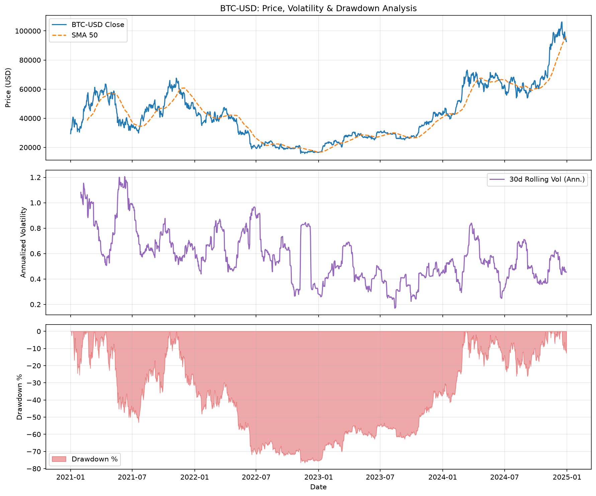

# Crypto Market Data Analyzer

[](https://crypto-market-analyzer.streamlit.app)

A modular Python data pipeline that ingests daily OHLCV market data for cryptocurrencies (BTC, ETH), performs rigorous data quality and integrity checks, computes quantitative performance metrics, and generates publication-grade visualizations.



---

## Architecture Flow

```mermaid
flowchart LR
    A[yfinance API] --> B[src/ingest.py]
    B --> C[data/raw/*.csv]
    C --> D[src/quality.py]
    D --> E[src/features.py]
    E --> F[src/plots.py]
    F --> G[reports/hero.png]

